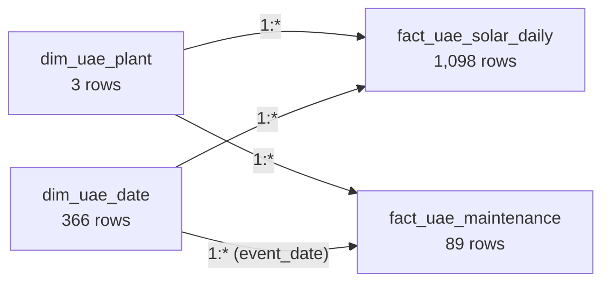

# UAE Solar Intelligence: project deep dive

How a business question became a governed data model and a four-page Power BI dashboard on Microsoft Fabric.

## 1. Business problem

A solar portfolio manager needs to know where the maintenance crew should go first. Two answers compete:

- **Plant C** has the largest total modeled loss: AED 464K.
- **Plant B** has the largest loss per installed megawatt: AED 25.8K per MW.

The project makes both visible, splits the loss into causes (baseline, soiling, outage), and ties the findings to maintenance history and carbon scenarios.

## 2. Data sources and classification

| Data | Origin | Status |
|---|---|---|
| Weather (irradiation, air temperature, wind, humidity) | NASA POWER, UAE 2024 | Real observations |
| Plants (A 10 MW, B 15 MW, C 20 MW), daily generation, losses | Simulated for this case study | Simulated |
| Maintenance work orders (cleanings and outages) | Simulated for this case study | Simulated |
| Tariff: AED 0.30 per kWh | Configuration assumption | Illustrative |
| Grid carbon factors (0.3833, 0.1870, 0.4697 kg CO2e/kWh) | Project assumptions for DEWA, EWEC and Ember scenarios | Provisional, no source URL recorded |

Every table carries a `data_classification` field so simulated and illustrative values cannot be mistaken for audited figures. The report states this on screen.

## 3. Architecture

Fabric workspace `uae-solar-dev` holds these items for the UAE dashboard branch:

| Layer | Item | Role |
|---|---|---|
| Ingest | `pl_02_ingest_nasa_power_weather` (Data Factory pipeline) | Pulls the NASA POWER UAE 2024 response into the Bronze lakehouse as raw JSON |
| Bronze | `lh_bronze` | Raw NASA POWER JSON file, kept unchanged |
| Silver | `nb_06_nasa_power_silver_transformation` (notebook) and `df_01_nasa_power_bronze_to_silver` (Dataflow Gen2) | Parse the JSON, rename and standardise weather fields, add location and source metadata, validate |
| Gold | `df_02_uae_solar_gold_model` (Dataflow Gen2) and `lh_gold` | Build the reporting tables: plant and date dimensions, daily solar fact, maintenance fact, configuration tables |
| Semantic model | `SM_UAE_Solar_Gold` (Direct Lake) | Star schema and 85 DAX measures |
| Report | Power BI report | Overview, Losses, Trends, Operations |

```
NASA POWER JSON -> Bronze lakehouse -> Silver (notebook / dataflow) -> Gold lakehouse tables (dataflow)
  -> Direct Lake semantic model -> Power BI report
```

### Silver step in detail (`nb_06_nasa_power_silver_transformation`)

1. Read the raw NASA POWER response from the Bronze lakehouse and fail loudly if the file is missing.
2. Extract the daily parameters and convert the date from `YYYYMMDD` to a real date.
3. Rename fields to readable names with units: `solar_irradiation_kwh_m2_day`, `air_temperature_c`, `wind_speed_m_s`, `relative_humidity_pct`.
4. Add metadata: location name (`Dubai_UAE_Scenario`), latitude, longitude and `source_system = NASA_POWER`.
5. Validate: row count, column list, duplicate dates and missing values.

The notebook is in [`fabric/notebooks`](../fabric/notebooks) with workspace IDs replaced by placeholders.

The Power Query logic of the two dataflows (including the plant simulation and loss calculation) is not yet exported to this repository.

### Separate engineering branch: US PVDAQ telemetry

The `fabric/` folder holds notebooks and a pipeline from an earlier branch that profiles and transforms US PVDAQ solar telemetry:

| Item | Purpose |
|---|---|
| `nb_01_PVDAQ_Source_Profiling` | Profile the source system and its metadata |
| `nb_02_pvdaq_silver_transformation` | Bronze to Silver cleaning and typing |
| `nb_03_ingest_pvdaq_telemetry` | Telemetry ingestion |
| `nb_04_gold_solar_model` | Gold tables: `dim_plant`, `dim_date`, `fact_solar_telemetry` (sampling intervals via window functions, kW conversion) |
| `pl_01_ingest_pvdaq_metadata` | Data Factory pipeline definition |

The US data and the UAE weather are not co-located, so this branch is kept apart. **No PVDAQ table exists in the dashboard's semantic model.**

## 4. Data model (star schema)



| Table | Grain | Notes |
|---|---|---|
| `dim_uae_plant` | one row per plant | name, capacity (kW), scenario type, cleaning interval, outage frequency |
| `dim_uae_date` | one row per calendar day, 1 Jan to 31 Dec 2024 | year, quarter, month, sort keys |
| `fact_uae_solar_daily` | one row per plant and day | weather, expected energy, simulated actual energy, loss split (baseline, soiling, outage), loss in AED, performance vs expected |
| `fact_uae_maintenance` | one row per work order | event type, date, downtime hours, status |
| `dim_assumptions` | one row per assumption | tariff, rates and units, kept disconnected on purpose |
| `dim_carbon_factor` | one row per grid scenario | kept disconnected so scenarios can be compared side by side |
| `dim_recommendation_rule` | one row per advisor rule | thresholds and recommended action |
| `security_user_plant_access` | user and plant mapping | prepared for row-level security; not deployed |

Design decisions:

- Four active one-to-many relationships, single-direction filtering, no many-to-many and no bidirectional links. Each dimension reaches each fact through exactly one filter path.
- Configuration tables stay disconnected because they hold alternatives (scenarios) or thresholds, not facts.
- All eight tables use Direct Lake on OneLake, with one entity partition each.

## 5. Data quality checks

Run against the live model before any report work:

| Check | Result |
|---|---|
| Dimension keys unique and non-blank (3 plants, 366 dates) | Pass |
| Date continuity, 366 consecutive days | Pass |
| Solar fact grain: 1,098 distinct plant-day pairs | Pass |
| Maintenance fact: 89 unique work orders, no negative durations | Pass |
| Null foreign keys, orphans | 0 and 0 |
| Plant filter propagation (Plant C: 366 solar rows, 41 work orders) | Matches direct fact filtering |
| Date filter propagation (January: 93 solar rows, 6 work orders) | Matches direct fact filtering |
| Duplicate plant attributes between fact and dimension | 0 discrepancies |
| Carbon factor source traceability | **Fail**: no source URL recorded, so factors are labelled provisional |

The one failure is reported, not hidden. It is why every carbon figure is labelled provisional.

## 6. DAX layer: 85 measures in 11 folders

| Folder | Examples |
|---|---|
| Core | Expected Generation MWh, Simulated Actual Generation MWh, Generation Gap MWh, Performance vs Expected %, Capacity Factor % |
| Time intelligence | Generation MTD / QTD / YTD, previous month, MoM %, rolling 7-day, financial loss MTD / QTD / YTD |
| Generation and performance | Rolling 30-day performance, performance ratio, average irradiation |
| Loss attribution | Baseline, soiling and outage loss in MWh, controllable loss, share of loss by driver, dominant loss driver |
| Financial | Estimated financial loss AED, loss per MW, plant rank by total loss and by loss per MW, controllable loss AED |
| Maintenance | Cleaning events, outage events, last cleaning date, average days since cleaning, downtime hours |
| Sustainability | Selected carbon factor, estimated avoided emissions tCO2e, emissions from lost generation |
| Advisor | Rule status, recommended action, maintenance priority |
| Narratives and story | Dynamic headline sentences and the story-card text, including a simulation disclosure |
| Weather | Average air temperature, wind speed, humidity |

Examples of the logic:

- `Expected Generation MWh = DIVIDE ( SUM ( fact_uae_solar_daily[expected_energy_kwh] ), 1000 )`
- `Performance vs Expected % = DIVIDE ( [Simulated Actual Generation MWh], [Expected Generation MWh] )`

Year-over-year measures exist but return blank, because the data covers a single year. No year-over-year visual was built.

## 7. Report layer

Four pages, each answering one question:

| Page | Question | What it contains |
|---|---|---|
| Overview | How much did we miss? | Generation, performance and financial-loss cards; a model-written headline sentence; generation year dial; expected-to-delivered waterfall; where to act first |
| Losses | Which driver first? | Estimated, soiling and outage loss cards; loss drivers by month; plant ranking; days with the largest shortfall |
| Trends | Which plant, which month? | Year-to-date and month-on-month generation; weather context; performance through the year; daily generation pulse; plant-by-month heat grid; share of output |
| Operations | What sits behind the numbers? | Emissions not avoided; maintenance work orders; days since cleaning; advisor rules; grid-factor comparison; avoided emissions by scenario; cleaning and outage events |

Build approach:

- The report is stored in the PBIR file format and generated by a script, so every page and visual is repeatable and reviewable.
- Custom visuals (gauges, rings, waterfall, year dial, ranking bars) are DAX measures that return SVG images. They work in the Power BI service with no custom-visual installation.
- Bookmarks flip each headline card to a story side. Hover tooltips tell a short story. A "How to read" guide, an advisor-rules overlay and a seven-step tutorial help new users.
- Slicers for plant, month, advisor rule and carbon scenario update every visual and the narrative sentences.
- Alt text on visuals, dark text on pastel fills for contrast, one colour per measure.

## 8. Results

| Finding | Value |
|---|---|
| Generated vs expected | 73,507 MWh vs 76,921 MWh |
| Shortfall | 3,413 MWh, about AED 1.02M of modeled loss |
| Largest total loss | Plant C, AED 464K |
| Largest loss per MW | Plant B, AED 25.8K per installed MW |
| Soiling share of the gap | about 48% |
| Maintenance history | 89 work orders: 55 cleanings, 34 outages, 68 hours of downtime |

The decision insight: the plant with the biggest bill is not the plant with the biggest efficiency problem, and soiling (cleaning records) is the first check.

## 9. Validation and limits

- Headline numbers were checked against DAX queries on the live model.
- Plants, generation, maintenance and losses are simulated. AED values use an illustrative tariff. Carbon factors are provisional.
- This is a historical analysis of 2024, not live monitoring and not a machine-learning forecast.
- Row-level security is designed (mapping table) but not deployed.

## 10. Skills shown

Microsoft Fabric (pipelines, lakehouses, OneLake, Dataflows Gen2), PySpark (PVDAQ branch), pandas, Delta tables, star-schema design, Direct Lake, DAX (time intelligence, loss attribution, dynamic narratives), Power BI report design (PBIR, bookmarks, tooltips, SVG visuals), data-quality testing, data governance labelling, and storytelling for decision makers.
